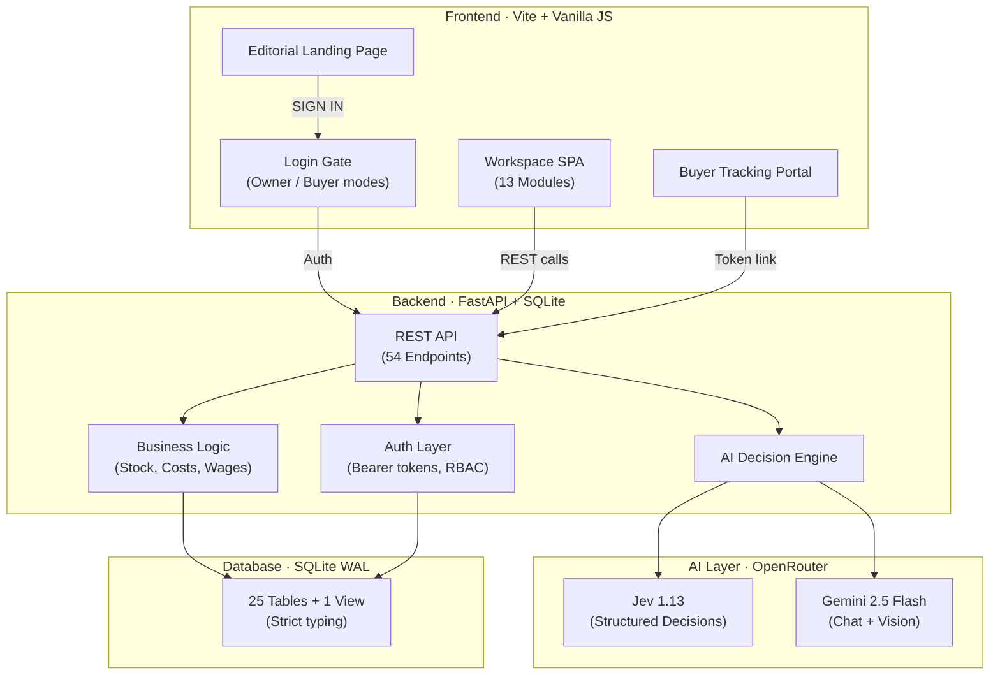
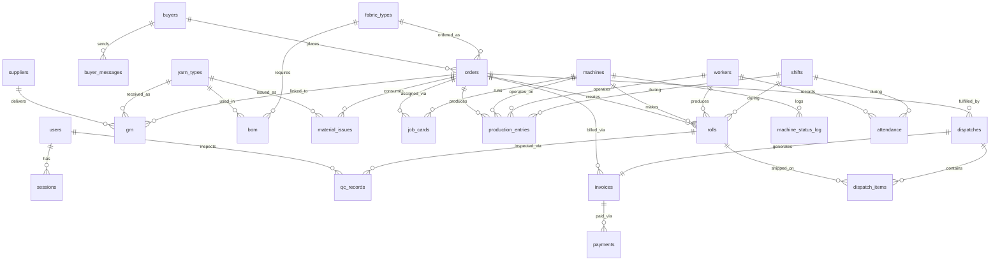
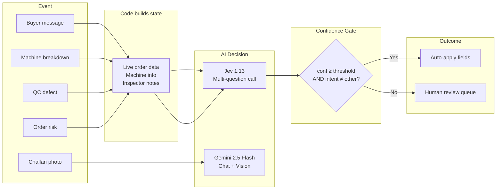
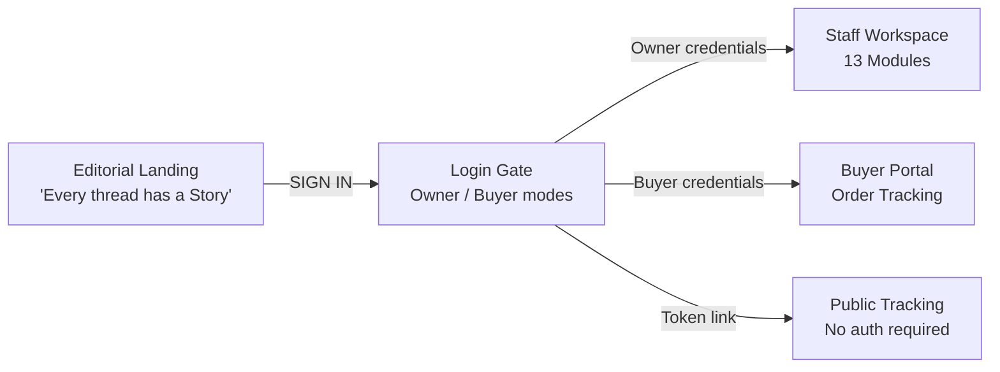
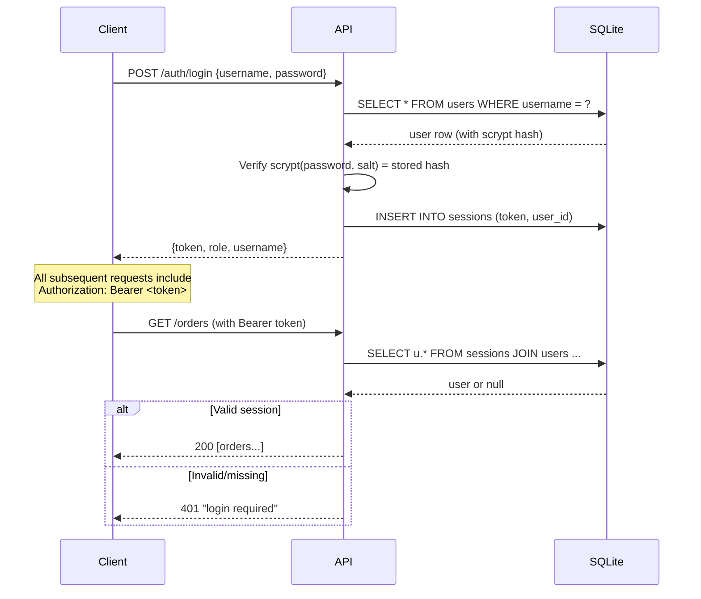
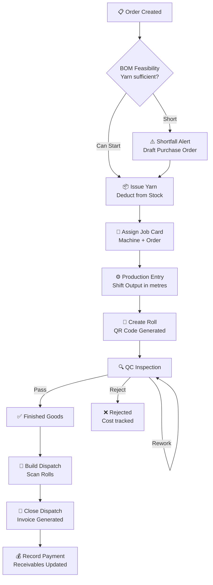

# WeaveSphere — Comprehensive Project Analysis

> **Everest Textile Mills · Textile Operations System**
> Repository: [WeaveSphere](file:///Users/subhashreepati/WeaveSphere)
> Analysis date: 2026-10-10

---

## Table of Contents

1. [Project Overview](#1-project-overview)
2. [Repository Structure](#2-repository-structure)
3. [System Architecture](#3-system-architecture)
4. [Technology Stack](#4-technology-stack)
5. [Database Design](#5-database-design)
6. [Backend — API Server](#6-backend--api-server)
7. [AI / ML Layer](#7-ai--ml-layer)
8. [Frontend — User Interface](#8-frontend--user-interface)
9. [Authentication & Authorisation](#9-authentication--authorisation)
10. [Feature Catalogue](#10-feature-catalogue)
11. [Business Logic & Workflows](#11-business-logic--workflows)
12. [Testing Strategy](#12-testing-strategy)
13. [Deployment & Configuration](#13-deployment--configuration)
14. [Design System & Aesthetics](#14-design-system--aesthetics)
15. [Known Limitations & Trade-offs](#15-known-limitations--trade-offs)
16. [Future Roadmap](#16-future-roadmap)

---

## 1. Project Overview

**WeaveSphere** (internally named **Everest Textile Mills**) is a **full-stack textile mill operations system** that digitises the complete lifecycle of fabric manufacturing — from raw material receipt to buyer delivery. It replaces scattered notebooks, WhatsApp chats, and manual registers with a single connected workspace.

### The Problem

Textile mills manage an intricate pipeline: yarn arrives from suppliers, moves through spinning, weaving, and dyeing machines, gets cut into rolls that must pass quality inspection, and finally ships to buyers with invoices. When these steps live in separate systems, small gaps cascade into:

- **Stock surprises** — yarn shortages discovered mid-production
- **Unanswered buyer queries** — "When will my order be ready?"
- **Quality blind spots** — no traceability from defect back to machine/shift/operator
- **Month-end chaos** — costing, wages, and P&L assembled by hand

### The Solution

A **role-based operations platform** with an **AI decision layer** that:

- Tracks every thread from goods receipt to dispatch
- Calculates stock, costs, and wages from transactional data (never stored balances)
- Uses **Jev** (a structured-decision AI) to triage breakdowns, route buyer messages, classify defects, and flag risky orders
- Falls back to a **human review queue** when AI confidence is low
- Generates buyer tracking links, invoices, packing lists, and P&L reports

### Tagline

> *"Every thread has a story."*

---

## 2. Repository Structure

```
WeaveSphere/
├── backend/
│   ├── app.py                 # FastAPI server — 959 lines, 54 endpoints
│   ├── ai.py                  # AI integration (OpenRouter) — 78 lines
│   ├── smoke_ai.py            # Live AI validation script
│   ├── requirements.txt       # Python dependencies
│   ├── db/
│   │   └── schema.sql         # SQLite schema — 25 tables + 1 view + 4 indexes
│   └── tests/
│       └── test_app.py        # End-to-end demo flow test
├── frontend/
│   ├── index.html             # Single-page app shell + editorial landing
│   ├── vite.config.mjs        # Vite dev server configuration
│   ├── package.json           # Node dependencies (GSAP, Vite)
│   ├── src/
│   │   ├── app.js             # Full application logic — ~185 lines (minified)
│   │   └── app.css            # Design system — ~69 lines (minified)
│   └── public/
│       └── assets/
│           ├── everest-weave.png
│           ├── textile-story-01.png
│           ├── textile-story-02.png
│           ├── textile-story-03.png
│           ├── textile-story-04.png
│           └── weaving.mp4        # Loom video (69 MB)
├── docs/
│   ├── backend.md             # API reference for frontend developers
│   └── status.md              # Feature coverage + AI calibration report
└── .gitignore
```

### File sizes at a glance

| Component | Lines | Bytes | Purpose |
|-----------|-------|-------|---------|
| [`app.py`](file:///Users/subhashreepati/WeaveSphere/backend/app.py) | 959 | 45 KB | All API endpoints and business logic |
| [`ai.py`](file:///Users/subhashreepati/WeaveSphere/backend/ai.py) | 78 | 3.9 KB | OpenRouter AI integration |
| [`schema.sql`](file:///Users/subhashreepati/WeaveSphere/backend/db/schema.sql) | 236 | 8.5 KB | Database schema |
| [`test_app.py`](file:///Users/subhashreepati/WeaveSphere/backend/tests/test_app.py) | 153 | 10 KB | End-to-end test |
| [`app.js`](file:///Users/subhashreepati/WeaveSphere/frontend/src/app.js) | 185 | 77 KB | Frontend application (minified) |
| [`app.css`](file:///Users/subhashreepati/WeaveSphere/frontend/src/app.css) | 69 | 35 KB | Design system (minified) |
| [`index.html`](file:///Users/subhashreepati/WeaveSphere/frontend/index.html) | 39 | 12 KB | HTML shell + editorial landing page |

---

## 3. System Architecture



### Architectural Principles

| Principle | Implementation |
|-----------|---------------|
| **Derived state, not stored state** | Yarn stock is a *view* computed from GRNs minus issues — it can never drift |
| **AI for classification, code for numbers** | AI routes messages and triages breakdowns; stock, guards, invoices, wages, and P&L are all plain arithmetic |
| **Confidence gating** | Every AI decision goes through a threshold gate; low-confidence decisions land in a human review queue |
| **Hard business rules in the DB** | CHECK constraints, UNIQUE indexes, and foreign keys enforce invariants at the schema level |
| **Role-based access** | 5 roles (owner, admin, store, supervisor, qc) with granular write permissions |
| **Transactional consistency** | SQLite `BEGIN IMMEDIATE` transactions for check-then-write sequences |

---

## 4. Technology Stack

### Backend

| Technology | Version | Purpose |
|-----------|---------|---------|
| **Python** | 3.12+ | Runtime |
| **FastAPI** | ≥ 0.115 | API framework |
| **Uvicorn** | ≥ 0.30 | ASGI server |
| **SQLite** | (stdlib) | Database (WAL mode) |
| **Pydantic** | (via FastAPI) | Request/response validation |
| **scrypt** | (stdlib hashlib) | Password hashing |

> [!NOTE]
> No ORM is used. All SQL is written directly, keeping the codebase compact and the queries explicit. SQLite's WAL mode enables concurrent reads with a single-writer lock.

### Frontend

| Technology | Version | Purpose |
|-----------|---------|---------|
| **Vite** | ^8.3.4 | Dev server and build tool |
| **Vanilla JS** | ES2022+ | Application logic (no framework for the workspace) |
| **GSAP** | ^3.14.2 | Scroll and animation library |
| **QRCode.js** | 1.0.0 (CDN) | Roll QR code generation |
| **Google Fonts** | — | Manrope + DM Mono typefaces |

> [!IMPORTANT]
> React and React DOM are listed in `package.json` but are **not used** in the current workspace codebase. The entire frontend is vanilla JS operating directly on the DOM. The dependencies appear to be holdovers or reserved for future use.

### AI / External Services

| Service | Model | Purpose |
|---------|-------|---------|
| **OpenRouter** | `typesafe/jev-1.13` | Structured multi-question decisions (classification, probability) |
| **OpenRouter** | `google/gemini-2.5-flash` | Natural language replies (English/Tamil/Hindi) + vision (challan photos) |

### Testing

| Tool | Purpose |
|------|---------|
| **pytest** | Test runner |
| **httpx** | FastAPI TestClient transport |
| **smoke_ai.py** | Live AI validation against OpenRouter |

---

## 5. Database Design

The database uses **SQLite in strict mode** with WAL journaling. All 25 tables are declared as `STRICT`, enforcing column types at the storage level.

### Entity-Relationship Diagram



### Table Catalogue

| # | Table | Purpose | Key constraints |
|---|-------|---------|-----------------|
| 1 | `users` | Staff accounts | UNIQUE(username), role CHECK |
| 2 | `sessions` | Bearer token sessions | token is PK |
| 3 | `buyers` | Customer master | — |
| 4 | `suppliers` | Yarn supplier master | — |
| 5 | `yarn_types` | Yarn specifications | UNIQUE(count, material, colour) |
| 6 | `fabric_types` | Fabric product catalog | UNIQUE(name), gst_rate ≥ 0 |
| 7 | `bom` | Bill of materials (yarn per metre of fabric) | UNIQUE(fabric_type, yarn_type), kg_per_m > 0 |
| 8 | `machines` | Factory equipment | UNIQUE(name), kind ∈ {spinning, weaving, dyeing} |
| 9 | `workers` | Employee roster | wage_type ∈ {daily, piece} |
| 10 | `shifts` | Shift definitions | UNIQUE(name) |
| 11 | `orders` | Buyer orders | UNIQUE(token), qty_m > 0, price_per_m ≥ 0 |
| 12 | `grn` | Goods Receipt Notes | qty_kg > 0, FK→supplier, yarn_type |
| 13 | `material_issues` | Yarn issued to production | qty_kg > 0, FK→order, yarn_type |
| 14 | `job_cards` | Machine-to-order assignments | status ∈ {open, done} |
| 15 | `machine_status_log` | Status change history | Includes breakdown triage fields |
| 16 | `attendance` | Worker attendance | UNIQUE(worker, date, shift) |
| 17 | `production_entries` | Shift output records | output ≥ 0, hours ≥ 0 |
| 18 | `rolls` | Finished fabric rolls | UNIQUE(qr), status lifecycle |
| 19 | `qc_records` | Quality inspection results | result ∈ {pass, rework, reject} |
| 20 | `dispatches` | Shipment records | status ∈ {open, closed} |
| 21 | `dispatch_items` | Rolls on a dispatch | UNIQUE(roll_id) — a roll ships once |
| 22 | `invoices` | Tax invoices | UNIQUE(dispatch_id) |
| 23 | `payments` | Buyer/supplier payments | party ∈ {buyer, supplier}, amount > 0 |
| 24 | `buyer_messages` | Inbound buyer communications | AI-routed with confidence score |
| 25 | `ai_reviews` | Human review queue for low-confidence AI | kind ∈ {message, breakdown, defect} |

### Computed View

| View | Purpose |
|------|---------|
| `yarn_stock` | **Live yarn stock** — `SUM(grn.qty_kg) - SUM(material_issues.qty_kg)` per yarn type, plus weighted-average purchase rate. Never stored, never drifts. |

### Indexes

```sql
ix_rolls_order               ON rolls (order_id, status)
ix_production_order          ON production_entries (order_id)
ix_production_machine_date   ON production_entries (machine_id, entry_date)
ix_jobs_order                ON job_cards (order_id)
```

---

## 6. Backend — API Server

The backend lives entirely in [`app.py`](file:///Users/subhashreepati/WeaveSphere/backend/app.py) — a single 959-line FastAPI application with 54 endpoints grouped into 10 functional domains.

### Endpoint Map (54 total)

#### Auth & Users (7 endpoints)
| Method | Path | Purpose | Access |
|--------|------|---------|--------|
| POST | `/auth/setup` | Create first owner (one-time bootstrap) | Open |
| POST | `/auth/login` | Authenticate → bearer token | Open |
| POST | `/auth/logout` | Invalidate token | Any |
| GET | `/me` | Current user info | Authenticated |
| POST | `/users` | Create staff account | Admin/Owner |
| GET | `/users` | List all users | Admin/Owner |

#### Master Data (3 endpoints)
| Method | Path | Purpose | Access |
|--------|------|---------|--------|
| GET | `/master/{table}` | List master records | Authenticated |
| POST | `/master/{table}` | Create master record | Admin |
| PUT | `/master/{table}/{id}` | Update master record | Admin |

Covers 8 tables: `buyers`, `suppliers`, `yarn_types`, `fabric_types`, `bom`, `machines`, `workers`, `shifts`.

#### Orders (5 endpoints)
| Method | Path | Purpose | Access |
|--------|------|---------|--------|
| POST | `/orders` | Create buyer order | Admin |
| GET | `/orders` | List all orders (with tracking) | Authenticated |
| GET | `/orders/{oid}` | Full order detail + feasibility | Authenticated |
| GET | `/orders/{oid}/feasibility` | BOM yarn check | Authenticated |
| GET | `/orders/{oid}/risk` | AI-powered deadline risk | Authenticated |

#### Raw Material (7 endpoints)
| Method | Path | Purpose | Access |
|--------|------|---------|--------|
| POST | `/grn` | Record goods receipt | Admin/Store |
| GET | `/grn` | List all GRNs | Authenticated |
| POST | `/grn/challan` | Photo → suggested GRN (AI vision) | Admin/Store |
| GET | `/stock` | Live yarn stock levels | Authenticated |
| GET | `/alerts/low-stock` | Reorder alerts | Authenticated |
| POST | `/issues` | Issue yarn to production | Admin/Store |
| GET | `/issues` | List material issues | Authenticated |

#### Production Floor (8 endpoints)
| Method | Path | Purpose | Access |
|--------|------|---------|--------|
| POST | `/jobs` | Assign job card | Admin/Supervisor |
| POST | `/jobs/{jid}/done` | Close job card | Admin/Supervisor |
| POST | `/machines/{mid}/status` | Update machine + breakdown triage | Admin/Supervisor |
| GET | `/machines/{mid}/log` | Machine status history | Authenticated |
| POST | `/production` | Log shift output | Admin/Supervisor |
| GET | `/floor` | Live floor dashboard | Authenticated |
| POST | `/rolls` | Create roll with QR code | Admin/Supervisor |
| GET | `/rolls/{qr}` | Full roll traceability | Authenticated |

#### Quality Control (2 endpoints)
| Method | Path | Purpose | Access |
|--------|------|---------|--------|
| GET | `/qc/queue` | Rolls awaiting inspection | Authenticated |
| POST | `/qc/{qr}` | Record QC result + AI classification | Admin/QC |

#### AI Review Queue (2 endpoints)
| Method | Path | Purpose | Access |
|--------|------|---------|--------|
| GET | `/reviews` | List open review items | Admin/Supervisor/QC |
| POST | `/reviews/{rid}` | Accept or correct AI suggestion | Admin/Supervisor/QC |

#### Dispatch & Invoicing (6 endpoints)
| Method | Path | Purpose | Access |
|--------|------|---------|--------|
| GET | `/finished-goods` | Passed rolls grouped by order | Authenticated |
| POST | `/dispatches` | Create dispatch | Admin/Store |
| POST | `/dispatches/{did}/scan` | Scan roll onto dispatch | Admin/Store |
| POST | `/dispatches/{did}/close` | Close + auto-generate invoice | Admin/Store |
| GET | `/dispatches` | Dispatch history | Authenticated |
| GET | `/dispatches/{did}` | Dispatch detail + packing list | Authenticated |

#### Workforce & Wages (2 endpoints)
| Method | Path | Purpose | Access |
|--------|------|---------|--------|
| POST | `/attendance` | Mark shift attendance | Admin/Supervisor |
| GET | `/wages` | Monthly wage report | Admin |

#### Accounts & Reports (7 endpoints)
| Method | Path | Purpose | Access |
|--------|------|---------|--------|
| POST | `/payments` | Record buyer/supplier payment | Admin |
| GET | `/reports/order-cost` | Cost breakdown all orders | Owner |
| GET | `/reports/order-cost/{oid}` | Cost breakdown single order | Owner |
| GET | `/reports/machines` | Machine output + breakdowns | Owner |
| GET | `/reports/receivables` | Buyer receivables | Admin |
| GET | `/reports/payables` | Supplier payables | Admin |
| GET | `/reports/pnl` | Monthly P&L statement | Owner |

#### Buyer Communication (5 endpoints)
| Method | Path | Purpose | Access |
|--------|------|---------|--------|
| POST | `/messages` | Receive buyer message + AI routing | Admin |
| GET | `/messages` | List messages (filter by status/dept) | Admin |
| POST | `/messages/{mid}/draft` | AI-generated reply (EN/TA/HI) | Admin |
| POST | `/messages/{mid}/reply` | Record sent reply | Admin |
| GET | `/track/{token}` | **Public** buyer tracking (no auth) | Open |

### Error Handling

All errors return `{"detail": "..."}` with user-friendly messages:

| Code | Meaning |
|------|---------|
| 401 | Not logged in or invalid token |
| 403 | Role doesn't have permission |
| 404 | Resource not found |
| 409 | Business rule violated (insufficient stock, duplicate, wrong order, blocked roll) |
| 422 | Validation error (missing/invalid fields) |
| 503 | AI service unavailable |

> [!TIP]
> The `409` responses are particularly well-designed — they include specific messages like "only 80 kg in stock", "BLOCKED: roll already scanned on dispatch #3", or "roll is passed, not awaiting QC".

---

## 7. AI / ML Layer

The AI integration in [`ai.py`](file:///Users/subhashreepati/WeaveSphere/backend/ai.py) is minimal by design (78 lines) and operates through **OpenRouter** with two models.

### Architecture



### AI Use Cases

#### 1. Buyer Message Routing ⭐
Classifies incoming buyer messages across **three dimensions simultaneously**:

| Dimension | Options |
|-----------|---------|
| **Department** | Office, QC, Production, Dispatch, Accounts |
| **Intent** | status, quality_complaint, payment, new_order, delivery_change, other |
| **Urgency** | low, med, high |

Each option has a carefully crafted description that Jev reads to make its decision. For example:
- `Production` = *"when goods will be ready, how far an order has progressed in the mill"*
- `high` urgency = *"the buyer's production, a deadline or money is at risk; answer within the hour"*

#### 2. Breakdown Triage
When a machine goes to "Breakdown" status with a note:

| Dimension | Options |
|-----------|---------|
| **Category** | mechanical, electrical, yarn_quality, operator |
| **Severity** | low, med, high |

The **assignee** is determined by a hard-coded rule (not AI):
- mechanical → fitter
- electrical → electrician
- yarn_quality → store
- operator → supervisor

#### 3. QC Defect Classification
When a roll fails or is sent to rework with notes:

| Dimension | Options |
|-----------|---------|
| **Defect type** | hole, colour_mismatch, uneven_weave, stain, other |
| **Stage at fault** | spinning, weaving, dyeing |
| **Severity** | low, med, high |

#### 4. Order Risk Assessment
A Jev **yes/no probability** question:
- State: progress %, days left, yarn shortfall, free machines
- Question: *"Will this order miss its deadline?"*
- Returns: probability 0.0–1.0 (at_risk if ≥ 0.5)

#### 5. Reply Drafting (Multilingual)
Uses Gemini 2.5 Flash to draft WhatsApp replies in **English**, **Tamil** (தமிழ்), or **Hindi** from live order data only — never invents dates or numbers.

#### 6. Challan Photo → GRN
Uses Gemini's vision capability to extract structured fields from a supplier delivery challan photo:
- supplier, challan_no, yarn_count, material, colour, qty_kg, rate

### Confidence Gating

```
threshold = float(os.environ.get("AI_THRESHOLD", "0.8"))

auto_apply = (confidence >= threshold) AND (intent != "other")
```

- **Auto-apply:** Write the fields directly to the database record
- **Human review:** Create an entry in `ai_reviews` table for manual resolution

### Graceful Degradation

> [!IMPORTANT]
> **Without an API key, nothing breaks.** Every AI decision goes to the human review queue, the risk endpoint returns `null`, and the reply-draft and challan endpoints return `503`.

### Live Performance

| Case | Confidence | Latency |
|------|-----------|---------|
| Clear buyer message → Production | 0.80–0.85 | 0.6–2.9 s |
| Ambiguous "hmm ok" → review queue | Auto-blocked (intent=other) | — |
| Yarn snapping → yarn_quality | 0.73–0.77 | 0.6–2.9 s |
| Order risk (30% done, 4 days, short 120 kg) | P(late) = 0.87–0.88 | 0.6–2.9 s |
| Tamil reply draft | Correct, live data only | 1.2–1.5 s |

---

## 8. Frontend — User Interface

The frontend is a **single-page application** with three major sections: an editorial landing page, a login gate, and a role-based workspace.

### Three-Phase User Journey



### Landing Page Features
- **Animated ribbon** of textile photography that sweeps across the viewport
- **Cinematic zoom** — a loom video tile expands to fill the screen
- **Scroll-driven editorial story** with parallax photography
- **Capability showcase** — 4 interactive cards (Store, Floor, Quality, Office)
- **Connected-records chart** — SVG data visualization showing material → output → quality → dispatch
- Accessible: `prefers-reduced-motion` disables all animations

### Login Gate
Two sign-in modes:
1. **Owner mode** — Mill ID + password, with fingerprint/passkey placeholder
2. **Buyer mode** — Email + password, with Google SSO placeholder

Demo credentials are exposed under a `<details>` toggle.

### Workspace — 13 Modules

| Module | Personas | Key Features |
|--------|----------|-------------|
| **Dashboard** | Owner | KPI cards, output chart (7-day/4-week), interactive 3D loom model, machine status board, orders needing attention, stock watch |
| **Orders** | Admin, Store | Create orders, BOM feasibility check, live computed stage, yarn shortfall detection, deadline risk badges |
| **Production** | Supervisor | Machine status board (one-tap update), job card assignment, shift output entry, roll creation with QR, breakdown/handover logs |
| **Inventory** | Store | GRN entry, material issue forms, live yarn stock (GRN − Issues), reorder alerts, purchase order drafting |
| **Quality** | QC | QC queue, pass/rework/reject with defect types, photo capture, rework loop |
| **Traceability** | Supervisor, QC | Roll lookup by QR/ID → order, machine, shift, operator, yarn lots, QC history, dispatch info |
| **Dispatch** | Admin, Store | Build shipments from passed rolls, hard guards (wrong order/already dispatched/not passed), packing list + invoice generation |
| **Tracking** | All + Buyer | Shareable buyer view with 5-step timeline, progress stats, dispatch details, copy share link |
| **Workforce** | Admin, Supervisor | Shift attendance, daily/piece wage rules, wage adjustments (advance/overtime/deduction), productivity table |
| **Accounts** | Admin, Owner | Buyer payments, supplier payments, expenses, order costing, receivables, payables, monthly P&L |
| **Masters** | Admin | Tabbed CRUD for all 7 master data tables with inline editing |
| **Reports** | Owner | Machine utilisation, defect analytics, output by machine, CSV export |
| **Settings** | All | Language toggle (English/Tamil), audit log, demo data reset, JSON backup export |

### Interactive 3D Loom Model

The dashboard includes a **real-time rendered 3D wireframe loom** drawn on a `<canvas>` element:
- Perspective projection with tilt
- Visible warp threads (alternating copper and cream)
- Weft threads (alternating beige and steel)
- **Animated shuttle** moving across the warp
- **Drag-to-rotate** interaction with pointer capture
- Auto-rotation when idle

### Local-First Architecture

The frontend prototype operates with **localStorage** as its data store:
- Seeded with realistic demo data (buyers, suppliers, yarns, fabrics, machines, workers, orders, rolls)
- All CRUD operations modify the local JSON store
- CSV export, JSON backup, and print/PDF support
- Audit log tracks all user actions with timestamps

> [!WARNING]
> The frontend currently does **not call the backend API**. It operates entirely on local browser storage with seed data. The backend API is fully built and documented in [`backend.md`](file:///Users/subhashreepati/WeaveSphere/docs/backend.md) for integration.

---

## 9. Authentication & Authorisation

### Backend Auth



### Password Security
- **Algorithm:** scrypt (n=16384, r=8, p=1)
- **Salt:** Random 16-byte hex per password
- **Storage:** `salt$hash` in the `pw_hash` column
- **Comparison:** Constant-time via `secrets.compare_digest()`

### Role-Based Access Control

| Role | Description | Write Access |
|------|------------|-------------|
| `owner` | Mill owner | **Everything** — inherits all permissions |
| `admin` | Office administrator | Users, master data, orders, GRN, issues, jobs, machine status, production, rolls, QC, dispatch, attendance, payments, messages, reviews |
| `store` | Store keeper | GRN, challan photo, material issues, dispatch |
| `supervisor` | Floor supervisor | Jobs, machine status, production, rolls, attendance, reviews |
| `qc` | QC inspector | QC results, reviews |

### Frontend Auth (Prototype)
The frontend uses a **hardcoded credential table** for demo purposes:

| Login ID | Role | Password |
|----------|------|----------|
| ETM-OWNER | Owner | everest-demo |
| ETM-ADMIN | Office / Admin | everest-demo |
| ETM-STORE | Store Keeper | everest-demo |
| ETM-FLOOR | Floor Supervisor | everest-demo |
| ETM-QC | QC Inspector | everest-demo |
| buying@meridian.example | Buyer | buyer-demo |
| orders@northloom.example | Buyer | buyer-demo |

---

## 10. Feature Catalogue

### Raw Material Management
- **Goods Receipt Notes (GRN)** — Record supplier deliveries with lot tracking
- **Live Yarn Stock** — Derived view (GRN − Issues), never stored, can't drift
- **Reorder Alerts** — Configurable per-yarn reorder levels
- **Material Issues** — Issue yarn against orders with stock guard (can't over-issue)
- **BOM Feasibility** — Compare order yarn needs against available stock
- **Challan Photo OCR** — AI-powered extraction from delivery photos

### Order Lifecycle
- **Order Creation** — Buyer, fabric, colour, quantity, deadline, price
- **Derived Status** — Computed from job cards, rolls, and dispatches: `Pending → Spinning → Weaving → Dyeing → In QC → Ready → Dispatched`
- **Deadline Risk** — AI probability assessment
- **Buyer Tracking Links** — Unique token-based URLs, no login required
- **ETA Calculation** — Based on rolling 7-day production rate

### Production Floor
- **Job Cards** — One open job per machine, auto-close on reassignment
- **Machine Status** — Running / Idle / Breakdown / Maintenance with full history
- **Breakdown Triage** — AI classifies category + severity → rule assigns technician
- **Shift Production** — Output in metres, machine hours
- **Roll Creation** — QR-coded fabric rolls linked to order, machine, shift, operator
- **Floor Dashboard** — Live view of all machines, jobs, and today's output

### Quality Control
- **QC Queue** — Rolls in `pending_qc` or `rework` status
- **Three-Outcome Inspection** — Pass / Rework / Reject
- **Defect Classification** — AI-assisted type, stage-at-fault, severity
- **Rework Loop** — Failed rolls return to the QC queue
- **Full Traceability** — Roll → order → buyer → machine → shift → operator → yarn lots → QC history → dispatch

### Dispatch & Invoicing
- **Finished Goods View** — QC-passed rolls grouped by order
- **Dispatch Building** — Scan rolls onto a dispatch
- **Hard Guards:**
  - ❌ Roll not QC-passed → blocked
  - ❌ Roll from wrong order → blocked
  - ❌ Roll already on another dispatch → blocked
- **Invoice Generation** — Auto-created when dispatch closes (subtotal + GST)
- **Packing List** — Roll-by-roll manifest

### Workers & Wages
- **Attendance** — Bulk shift attendance in one call
- **Wage Rules:**
  - Daily workers: rate × days present
  - Piece workers: rate × output metres
- **Cost Attribution** — Daily worker wages split proportionally by hours on each order

### Financial Reports
- **Per-Order Costing** — Yarn (avg rate × kg) + wages + machine overhead
- **Receivables** — Invoice totals minus buyer payments
- **Payables** — GRN totals minus supplier payments
- **Monthly P&L** — Revenue (ex-GST) − yarn − wages − overhead

### Buyer Communication
- **Message Inbox** — WhatsApp/email/phone messages with AI routing
- **AI Reply Drafting** — English, Tamil, Hindi from live order data
- **Department Routing** — Office, QC, Production, Dispatch, Accounts
- **Human Review Queue** — Low-confidence AI decisions for manual resolution

---

## 11. Business Logic & Workflows

### Order-to-Dispatch Workflow



### Yarn Stock Calculation

```
yarn_stock = Σ(grn.qty_kg WHERE yarn_type_id = X) 
           - Σ(material_issues.qty_kg WHERE yarn_type_id = X)

avg_rate   = Σ(grn.qty_kg × grn.rate) / Σ(grn.qty_kg)
```

This is a SQL **view**, not a stored value. Every query sees the current truth.

### Order Status Derivation

```python
if dispatches with status='closed' exist     → "Dispatched"
elif QC-passed metres ≥ target              → "Ready"
elif rolls in pending_qc or rework          → "In QC"
elif job cards exist on dyeing machines     → "Dyeing"
elif job cards exist on weaving machines    → "Weaving"
elif job cards exist on spinning machines   → "Spinning"
else                                        → "Pending"
```

### Per-Order Cost Calculation

```
Yarn cost     = Σ(issued_kg × weighted_avg_rate)
Piece wages   = Σ(output × piece_rate)  for piece workers on this order
Daily wages   = Σ(daily_rate × hours_on_order / total_hours_that_day)
Overhead      = Σ(machine_hours × overhead_per_hour)
────────────────────────────────────────────
Total cost    = yarn + wages + overhead
Revenue       = Σ(invoice subtotals)
Margin        = revenue − total cost
```

### Dispatch Guards (Hard Rules)

```python
# 1. Dispatch must be open
if dispatch.status != "open":
    raise 409 "dispatch is closed"

# 2. Roll must exist
if not roll:
    raise 404 "unknown roll"

# 3. Not already shipped
if roll on another dispatch:
    raise 409 "BLOCKED: roll already scanned on dispatch #N"

# 4. Right order
if roll.order_id != dispatch.order_id:
    raise 409 "BLOCKED: roll belongs to order #X, not #Y"

# 5. QC passed
if roll.status != "passed":
    raise 409 "BLOCKED: roll is {status}, not QC-passed"
```

---

## 12. Testing Strategy

### End-to-End Test ([`test_app.py`](file:///Users/subhashreepati/WeaveSphere/backend/tests/test_app.py))

A single comprehensive test walks the entire demo script:

| Step | What's tested |
|------|--------------|
| **Auth** | Owner setup (once-only), user creation, role enforcement, login |
| **Validation** | Unknown fields rejected, duplicate names caught, missing fields reported |
| **Step 1** | GRN → stock increases → low-stock alert fires |
| **Step 2** | Order created → "short by 120 kg" → restock → "can start" → issue yarn (over-issue blocked) |
| **Step 3** | Job card → machine running → production logged → breakdown triaged (mocked Jev with confidence=1.0 → auto-applied as mechanical/fitter) → message routed |
| **Step 4** | 3 rolls created → QC queue → reject (needs notes) → rework → pass → traceability verified (machine, shift, operator, yarn lots) |
| **Step 5-6** | Buyer tracking link works → ambiguous message goes to review → accept AI suggestion |
| **Step 7** | Wrong-order roll blocked → rejected roll blocked → scan + close → invoice generated (subtotal, GST, total verified) → duplicate scan blocked → payment recorded → receivable checked |
| **Step 8** | Attendance → wages verified (piece: 1000m × ₹2, daily: 1 day × ₹500) → order cost verified (yarn: 200kg × ₹300, wages, overhead: 18h × ₹50) → P&L verified (revenue ₹100,000, costs ₹63,400, profit ₹36,600) → payables verified |

### AI Smoke Test ([`smoke_ai.py`](file:///Users/subhashreepati/WeaveSphere/backend/smoke_ai.py))

Live validation against OpenRouter (costs a few cents):
- Clear buyer message routing
- Ambiguous message handling
- Breakdown triage
- QC defect classification
- Order risk probability
- Tamil reply draft
- Optional: challan photo extraction

### Running Tests

```bash
cd backend && python3 -m pytest -q tests       # Offline, instant
cd backend && OPENROUTER_API_KEY=... python3 smoke_ai.py [challan.jpg]  # Live AI
```

---

## 13. Deployment & Configuration

### Environment Variables

| Variable | Default | Purpose |
|----------|---------|---------|
| `DB_PATH` | `mill.db` | SQLite database file path |
| `CORS_ORIGINS` | `http://localhost:5173` | Comma-separated allowed origins |
| `OPENROUTER_API_KEY` | *(none)* | Required for AI features |
| `AI_THRESHOLD` | `0.8` | Confidence gate (use 0.7 for demo) |
| `JEV_MODEL` | `typesafe/jev-1.13` | Structured decision model |
| `CHAT_MODEL` | `google/gemini-2.5-flash` | Chat + vision model |

### Running Locally

```bash
# Backend
cd backend
pip install -r requirements.txt
AI_THRESHOLD=0.7 OPENROUTER_API_KEY=sk-or-v1-... uvicorn app:app --reload
# API docs at http://localhost:8000/docs

# Frontend
cd frontend
npm install
npm run dev
# Dev server at http://localhost:5173
```

### Database

- SQLite with **WAL journaling** for concurrent reads
- Schema auto-applied on startup (idempotent `CREATE IF NOT EXISTS`)
- `PRAGMA foreign_keys = ON` — referential integrity enforced
- `PRAGMA busy_timeout = 5000` — 5-second wait on lock contention
- Delete `mill.db` to reset everything

---

## 14. Design System & Aesthetics

### Color Palette

| Token | Hex | Usage |
|-------|-----|-------|
| `--bg` | `#141517` | Background |
| `--panel` | `#1c1d1f` | Panel surface |
| `--panel2` | `#252629` | Elevated surface |
| `--paper` | `#ecece4` | Print background |
| `--text` | `#f2f2eb` | Primary text |
| `--muted` | `#97a197` | Secondary text |
| `--line` | `#ffffff1a` | Borders and dividers |
| `--cyan` | `#d49a62` | **Primary accent (warm copper)** |
| `--lime` | `#d8b18a` | Secondary warm tone |
| `--amber` | `#edc47d` | Warning indicators |
| `--red` | `#ef897b` | Error/danger indicators |

### Typography

| Typeface | Stack | Usage |
|----------|-------|-------|
| **Manrope** | `'Manrope', Arial, sans-serif` | All body text, headings, UI |
| **DM Mono** | `'DM Mono', monospace` | Labels, badges, data cells, navigation |

### Design Language

- **Dark theme** — Charcoal backgrounds with warm copper accents
- **Editorial opening** — Full-bleed photography, cinematic typography (clamp-based responsive sizing)
- **Industrial aesthetic** — Monospaced labels, machine-like precision in data tables
- **Micro-animations** — Bar chart rise, shuttle animation, hover lifts on capability cards
- **Glassmorphism** — Backdrop blur on the topbar and mobile sidebar
- **Responsive breakpoints** — 1100px, 720px, 480px, 420px with full print stylesheet

### Badge System

| Tone | Pattern | Color |
|------|---------|-------|
| Default (good) | Passed, Running, Ready, Available | Copper |
| Warning | Idle, Rework, Hold, Short, Risk, Pending | Amber |
| Bad | Breakdown, Rejected, Failed, Blocked | Red |
| Neutral | Fallback | Muted grey |

---

## 15. Known Limitations & Trade-offs

These are documented with `ponytail:` comments in the source code:

| Limitation | Where | Impact | Upgrade path |
|-----------|-------|--------|-------------|
| Yarn priced at **average** GRN rate | `schema.sql` yarn_stock view | Slightly imprecise costing | FIFO requires lot tracking |
| Feasibility checks **one order** at a time | `app.py` feasibility() | Two orders can both count on the same stock | Reserve stock on order creation |
| ETA from **last 7 days** of output | `app.py` expected_ready() | Naive if production is uneven | Per-stage scheduling |
| Daily wage per **day present** | `app.py` wages() | No overtime premium | Add overtime/advance tracking |
| **Rounded decimals** for money | Throughout | Auditable accounting needs precise calculations | Use integer paise/cents |
| Some list endpoints run **one query per order** | `/orders`, `/floor` | Slow with hundreds of active orders | Denormalise or batch |
| Frontend **does not call the API** | `app.js` | Prototype with localStorage only | Wire up REST calls |
| No **WhatsApp/email delivery** | Messages | Reply recorded but not sent | Integration layer needed |
| No **purchase orders** workflow | Frontend only | Draft POs but no lifecycle | Backend PO endpoints |
| No **partial dispatch** | Backend | All metres of a roll ship together | Split roll on scan |
| Sessions **never expire** | Auth | Security risk in production | Add TTL + refresh |
| No **password reset** or user deletion | Auth | Admin must recreate accounts | Add reset endpoint |

---

## 16. Future Roadmap

### Immediate (connect frontend to backend)
1. Wire up all 54 API endpoints to the frontend workspace modules
2. Replace localStorage with authenticated REST calls
3. Test challan photo reading with real supplier challans
4. Commit all pending changes (OpenRouter switch, gate fixes, smoke_ai.py)

### Near-term
5. QR code camera scanning (frontend)
6. Invoice number formatting and PDF generation
7. Mobile-optimised screens for floor supervisors and QC inspectors
8. WhatsApp Business API integration for message delivery
9. Session expiry and refresh tokens

### Medium-term
10. Yarn lot tracking → FIFO costing
11. Per-stage production scheduling → better ETAs
12. Multi-order stock reservation
13. Overtime and advance tracking for wages
14. Photo-based defect detection (AI vision for QC)
15. Audit log in the backend (currently frontend-only)

### Long-term
16. Multi-mill support
17. Supplier portal (PO acceptance, delivery scheduling)
18. Business intelligence dashboards
19. E-way bill integration (GST)
20. Voice interface for floor data entry

---

> [!NOTE]
> This document was generated from a complete analysis of every file in the repository. For the interactive API reference, run the backend and visit `http://localhost:8000/docs`.
